 

---

## Sobre mí

Soy **Ingeniero en Sistemas** en formación (CUN, 5.º semestre) y **Tecnólogo en Análisis y Desarrollo de Software** del SENA. Me enfoco en el desarrollo **Full Stack**: interfaces limpias y responsivas, APIs bien estructuradas y bases de datos eficientes.

- Construyendo proyectos con **React, Next.js y Node.js**.
- Aprendiendo **Python para análisis de datos** y automatización.
- Me gusta resolver problemas, aprender rápido y escribir código claro.
- Abierto a oportunidades **Junior**, prácticas y proyectos freelance.

> "La simplicidad es la máxima sofisticación." — Leonardo da Vinci

---

## Stack tecnológico

  

 

  
  
  
  

---

## Proyectos destacados

<table>
  <tr>
    <td width="50%" valign="top">
      <h3>CapiFront</h3>
      
Dashboard de finanzas personales con autenticación, gráficos, metas de ahorro, presupuestos y asistente IA integrado.

      
<code>Next.js</code> <code>React</code> <code>TypeScript</code> <code>TailwindCSS</code>

      <a href="https://github.com/josuealvarez21/CapiFront">Ver repositorio →</a>
    </td>
    <td width="50%" valign="top">
      <h3>Documeton</h3>
      
Script en Python que consolida reportes de ventas de varias sucursales, limpia los datos y genera Excel, gráficos y un resumen ejecutivo automático.

      
<code>Python</code> <code>pandas</code> <code>Matplotlib</code> <code>Automatización</code>

      <a href="https://github.com/estebanrpodev/documeton-DataFrame">Ver repositorio →</a>
    </td>
  </tr>
  <tr>
    <td width="50%" valign="top">
      <h3>Landing Page — Portafolio</h3>
      
Portafolio profesional SPA con diseño oscuro, acentos en verde esmeralda, navegación suave y animaciones.

      
<code>React</code> <code>Vite</code> <code>TailwindCSS</code> <code>lucide-react</code>

      <a href="https://github.com/estebanrpodev/landing_page_Esteban">Ver repositorio →</a>
    </td>
    <td width="50%" valign="top"></td>
  </tr>
</table>

---

## Estadísticas de GitHub

  

  
  

  
  

 

  

---

## Contribuciones

  <picture>
    <source media="(prefers-color-scheme: dark)" srcset="https://raw.githubusercontent.com/estebanrpodev/estebanrpodev/output/github-snake-dark.svg" />
    <source media="(prefers-color-scheme: light)" srcset="https://raw.githubusercontent.com/estebanrpodev/estebanrpodev/output/github-snake.svg" />
    
  </picture>

---

## Contacto

  
  
  

 

  

